## Olá, eu sou o Daniel 👋

Desenvolvedor web de Goiânia (GO) e estudante de Análise e Desenvolvimento de Sistemas.
Construo sistemas simples de usar para o dia a dia de negócios: rápidos, que rodam no celular
e que a equipe aprende a usar em minutos.

### 🚀 Rodando hoje

### 🛠️ Tecnologias

  
  
  
  
  
  
  
  
  
  
  
  
  
  
  
  
  
  
  
  
  

### 📫 Contato

